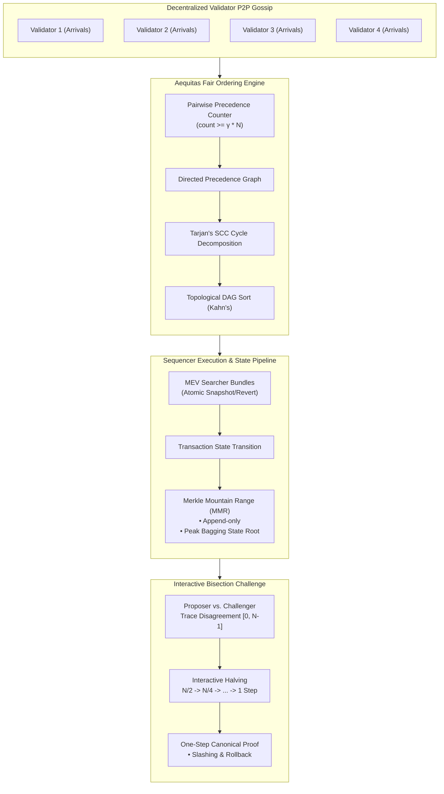
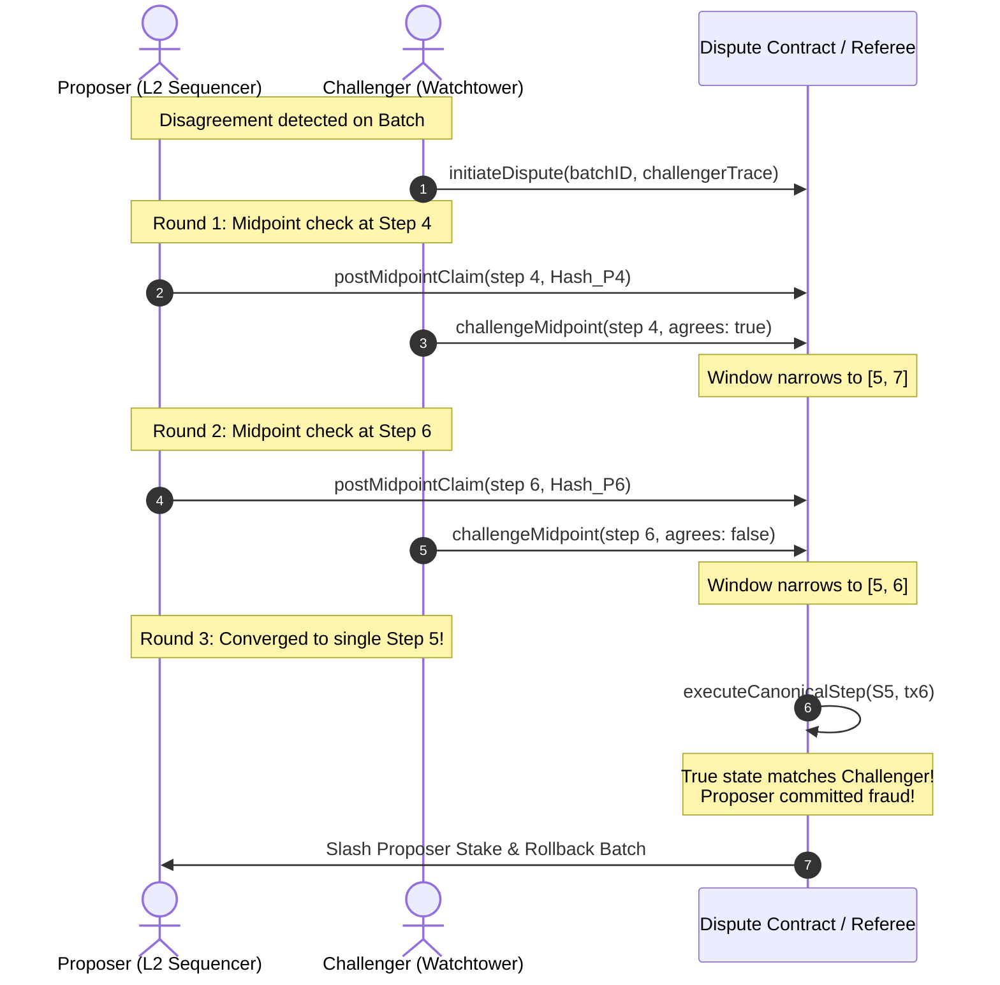

# ZenithSequencer

[](https://github.com/ZengLLQ/zenith-sequencer/actions/workflows/ci.yml)
[](https://golang.org/)
[](https://opensource.org/licenses/MIT)

> **High-Throughput Decentralized Rollup Sequencer Engine in Go 1.26 featuring Aequitas Receive-Time Order Fairness, Atomic MEV Searcher Bundles, Merkle Mountain Range (MMR) State Roots, and Interactive Bisection Fraud Dispute Resolution.**

---

## 1. System Architecture & Theory

Centralized sequencers in Layer-2 optimistic and ZK rollups represent a critical single point of failure (SPOF) and an unchecked vector for **Maximal Extractable Value (MEV)** extraction (front-running, sandwiching, and censorship).

`ZenithSequencer` introduces a decentralized sequencer network architecture grounded in distributed systems theory:

1. **Aequitas Fair Ordering (Kelkar et al., 2020)**: Transactions arriving at distributed validator nodes are sequenced according to majority arrival times ($\gamma$-fair ordering). Precedence cycles are mathematically decomposed into Strongly Connected Components (SCC) using **Tarjan's algorithm** and topologically sorted.
2. **Atomic MEV Bundle Sandbox**: Searcher bundles execute with full state snapshot reversibility. If any transaction in a bundle reverts or violates gas bids, all state modifications within the bundle are rolled back atomically.
3. **Merkle Mountain Range (MMR) State Roots**: Rollup state transitions are committed to an append-only Merkle Mountain Range. The definitive state root is derived by "bagging the peaks", providing $\mathcal{O}(\log N)$ logarithmic inclusion proofs without trie rebalancing overhead.
4. **Interactive Bisection Fraud Proof Game**: Disagreements between L2 Proposers and Challengers are resolved through an interactive binary search bisection protocol. In $\lceil \log_2 N \rceil$ rounds, the conflict narrows to a single disputed transaction step, where canonical execution deterministically slashes the fraudulent party.



---

## 2. Mathematical Formalization

### 2.1 Aequitas Receive-Time Order Fairness

Let $\mathcal{V} = \{v_1, \dots, v_n\}$ denote the set of active validator nodes. For transactions $tx_A$ and $tx_B$, node $v_k$ observes local arrival times $\tau_{v_k}(tx_A)$ and $\tau_{v_k}(tx_B)$.

For fairness parameter $\gamma \in (0.5, 1.0]$, a directed precedence edge $tx_A \to tx_B$ is established if:

$$\frac{1}{n} \sum_{k=1}^n \mathbb{I}\Big(\tau_{v_k}(tx_A) < \tau_{v_k}(tx_B)\Big) \ge \gamma$$

Cycles arising from network latency jitter (e.g. $A \to B \to C \to A$) are resolved by partitioning the directed graph $G = (V, E)$ into Strongly Connected Components:

$$\mathcal{C} = \text{TarjanSCC}(G)$$

The condensation DAG $G^{\text{SCC}}$ is sorted topologically:

$$\text{TotalOrder} = \text{TopologicalSort}(G^{\text{SCC}})$$

Within each component $C_i \in \mathcal{C}$, transactions are deterministically sequenced by hash, completely eliminating front-running incentives.

### 2.2 Merkle Mountain Range (MMR) & Peak Bagging

The number of leaves $N$ decomposes uniquely into descending powers of two:

$$N = \sum_{k=0}^{\lfloor \log_2 N \rfloor} c_k 2^k, \quad c_k \in \{0, 1\}$$

Each bit $c_k = 1$ corresponds to a mountain of height $k$ with peak hash $P_k$. The definitive rollup state root $\mathcal{R}$ is computed by recursively hashing the peaks from right to left:

$$\mathcal{R} = P_0 \otimes \Big( P_1 \otimes \big( \dots \otimes (P_{m-1} \otimes P_m) \dots \big) \Big)$$

### 2.3 Interactive Bisection Protocol

Given proposer trace $\mathcal{T}_{\text{prop}} = \{S_0, S_1, \dots, S_N\}$ and challenger trace $\mathcal{T}_{\text{chal}} = \{S'_0, S'_1, \dots, S'_N\}$ where $S_0 = S'_0$ and $S_N \ne S'_N$:

At round $r$, parties query the midpoint $m = \lfloor (l + h)/2 \rfloor$:

$$[l_{r+1}, h_{r+1}] = \begin{cases} [m+1, h_r] & \text{if } S_m = S'_m \\ [l_r, m] & \text{if } S_m \ne S'_m \end{cases}$$

The search space contracts logarithmically:

$$|h_r - l_r| = \left\lceil \frac{N}{2^r} \right\rceil$$

Terminating in exactly $R = \lceil \log_2 N \rceil$ rounds at a single step $k$ where:

$$S_k = S'_k \quad \land \quad S_{k+1} \ne S'_{k+1}$$



---

## 3. Repository Structure

```
zenith-sequencer/
├── .github/
│   └── workflows/
│       └── ci.yml                 # Automated Go build, fmt, and test CI
├── cmd/
│   └── zenith/
│       └── main.go                # Comprehensive end-to-end CLI demonstration
├── pkg/
│   ├── aequitas/
│   │   ├── fair_order.go          # Aequitas γ-fair ordering & Tarjan SCC solver
│   │   └── fair_order_test.go     # Unanimous, cycle, and majority precedence tests
│   ├── dispute/
│   │   ├── interactive_bisection.go # Interactive bisection game & one-step proof
│   │   └── dispute_test.go        # Convergence and slashing unit tests
│   ├── mmr/
│   │   ├── mmr.go                 # Merkle Mountain Range & peak bagging
│   │   └── mmr_test.go            # Peak decomposition & inclusion proof tests
│   ├── sequencer/
│   │   ├── sequencer.go           # Mempool, atomic MEV bundles, and batch pipeline
│   │   └── sequencer_test.go      # Transaction execution and bundle revert tests
│   └── types/
│       └── transaction.go         # Transaction, Bundle, AccountState data types
├── go.mod                         # Go 1.26 module definition
├── LICENSE                        # MIT License
└── README.md
```

---

## 4. Getting Started & Verification

### Prerequisites
- [Go 1.26+](https://golang.org/dl/)

### Run Test Suite
```bash
go test -v ./...
```

### Check Code Formatting
```bash
gofmt -s -d .
```

### Run Demonstration
```bash
go run ./cmd/zenith
```

---

## 5. Test Suite Coverage

| Package | Test Name | Target Behavior |
|:---|:---|:---|
| `pkg/aequitas` | `TestAequitas_UnanimousOrdering` | Verifies identical total order when all nodes agree |
| `pkg/aequitas` | `TestAequitas_CycleResolutionViaSCC` | Resolves adversarial cyclic dependencies $A \to B \to C \to A$ using Tarjan's SCC |
| `pkg/aequitas` | `TestAequitas_MajorityPrecedence` | Enforces majority precedence when $\ge \gamma \cdot N$ validators observe $tx_A \prec tx_B$ |
| `pkg/mmr` | `TestMMR_AppendAndPeakDecomposition` | Verifies dynamic peak decomposition into binary powers ($11 = 8 + 2 + 1$) |
| `pkg/mmr` | `TestMMR_InclusionProofs` | Tests logarithmic inclusion proofs and rejection of tampered leaves |
| `pkg/sequencer` | `TestSequencer_TransactionExecutionAndBalanceAccounting` | Verifies account debits, gas fees, and nonce updates |
| `pkg/sequencer` | `TestSequencer_AtomicMEVBundleReversion` | Proves all bundle mutations revert atomically if any transaction fails |
| `pkg/dispute` | `TestDispute_BisectionConvergence` | Validates $\lceil \log_2 N \rceil$ convergence to single disputed transaction step |

---

## 6. License

This project is licensed under the MIT License — see the [LICENSE](LICENSE) file for details.
